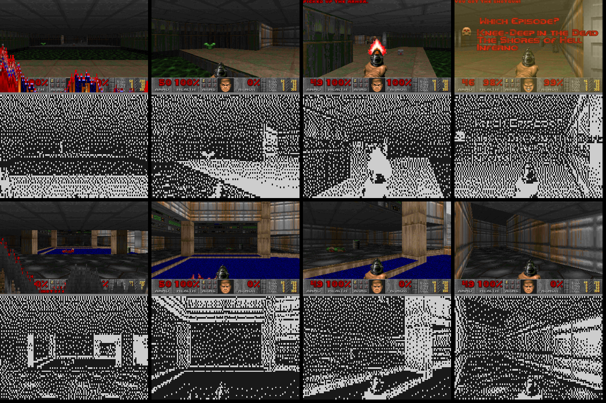

# Zoom MS Doom CFW

Doom on a Zoom MultiStomp guitar pedal: a custom firmware for the **MS-60B** and
**MS-70CDR** that boots straight into Doom (shareware episode 1) on the pedal's
128×64 LCD. Runs on the pedal's own TI C674x DSP at 300 MHz. No effects in this
firmware — it is a separate one; flash a normal updater to get the pedal back.

Русская версия: [README.ru.md](README.ru.md).



Status: works on a real MS-60B (2026-10-28). The MS-70CDR has the same board and OS;
not tried on one yet. No sound yet.

## Safety and going back

The pedal's bootloader (flash 0x00000–0x3FFFF) is **never written**: the updater's
bootloader steps are switched off. So you can always go back:

1. Switch the pedal off, hold **up + down** (the effect type buttons), switch it on —
   the screen says FIRMWARE UPDATE.
2. Run Zoom's stock `MS-70CDR v2.10` updater (or the MS-60B one) — firmware and stock
   effects come back.

Close Ableton, browser tabs with Web MIDI and anything else using the pedal's MIDI port
before flashing. Flashing takes noticeably longer than a normal update (the file system
with Doom is written too).

## Controls

| Control | In the game | In menus |
|---|---|---|
| D-pad up / down | forward / back | up / down |
| D-pad left / right | strafe | left / right |
| knob 1 | turn, 10° per click | left / right |
| knob 2 | previous / next weapon | up / down |
| knob 3 | automap on / off | — |
| knob 3 press (right) | fire | |
| knob 1 press, footswitch | use (doors, switches) | Enter |
| knob 2 press | menu (Esc) | Esc |

Always run. Keys are debounced; the knobs are read in the GPIO interrupt, like the
stock OS does, so fast turns don't lose clicks.

## Building

Needs (none of it is in this repository):

- TI C6000 code generation tools 8.5.0 (`cl6x`, comes with Code Composer Studio) —
  `TI_CGT_C6000`;
- Zoom's `ZOOM MS-70CDR v2.10 Updater.exe` (zoom.co.jp) — `ZOOM_UPDATER_70CDR`,
  default: next to `paths.py`;
- `doom1.wad`, the shareware IWAD (1.9) — `DOOM_WAD`, default: next to `paths.py`;
- Python 3.10+ with Pillow and numpy (only for the boot logo).

```bash
git clone --recursive https://github.com/Senty3kat/zoom-ms-doom-cfw.git
cd zoom-ms-doom-cfw
python -I build_cfw.py            # -> out/DialUp-DOOM-ms70cdr-2.10.exe
```

The updater is Zoom's own, re-scripted by [zoomms](https://github.com/matujuice/zoom-ms-midistomp):
OS + logo + hook, and the file system with `DOOM.BIN` and the deflated WAD. The
bootloader steps stay off.

## How it works

| Part | Where | What |
|---|---|---|
| hook | OS, `0xC00BB144` | the boot screen call goes to a trampoline at `0xC00F4000` → `doom_hook` |
| loader | shared RAM `0x80000000` (`loader/`) | boot logo; interrupts off; stops EDMA, McASP, USB; reads the file system over SPI0; inflates the WAD; jumps to Doom |
| Doom | SDRAM `0xC0000000–0xC03FFFFF` | code, data, stack, heap (2 MB zone) |
| WAD | SDRAM `0xC03FF000–0xC07FFFFF` | doom1.wad, inflated by the loader |
| screen | `zd_lcd.h` | own copy of the OS driver's ST7565 sequence (CS, D/C, PINMUX7) |
| controls | `zd_pedal.c`, `zd_vectors.asm` | buttons polled and debounced, encoders in the GPIO bank 1 interrupt (INT8) |
| files | pedal file system | `DOOM.BIN` (Doom's segments), `DOOM.WDZ` (WAD, deflate), empty `FLST_SEQ.ZDT` |

Doom itself is [doomgeneric](https://github.com/ozkl/doomgeneric) (submodule, unchanged)
plus `zd_platform.c` / `zd_pedal.c`. The 320×200 frame becomes 128×64: in a level only
the 3D view, sharpened, auto levels, error diffusion.

Developed and tested first in an emulator of the pedal (C674x CPU, McASP, SPI flash,
LCD, USB MIDI, the real bootloader) before it ever touched hardware.

## Not there yet

- Sound.
- Saving games (nothing is written to flash, on purpose).

## Licence

GPL-3.0-or-later (`LICENSE`). doomgeneric is GPL-2.0-or-later, zoomms is MIT.
DOOM is a trademark of id Software; the WAD and Zoom's firmware are not included.
